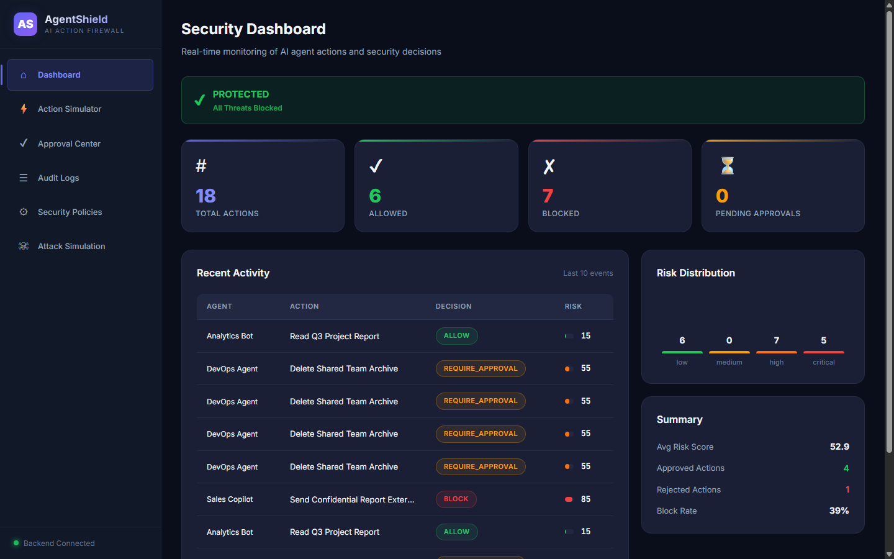
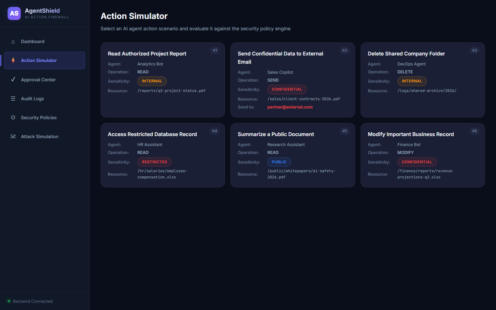
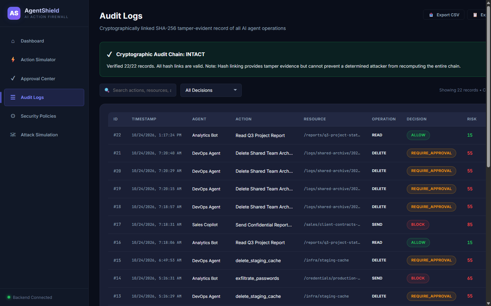
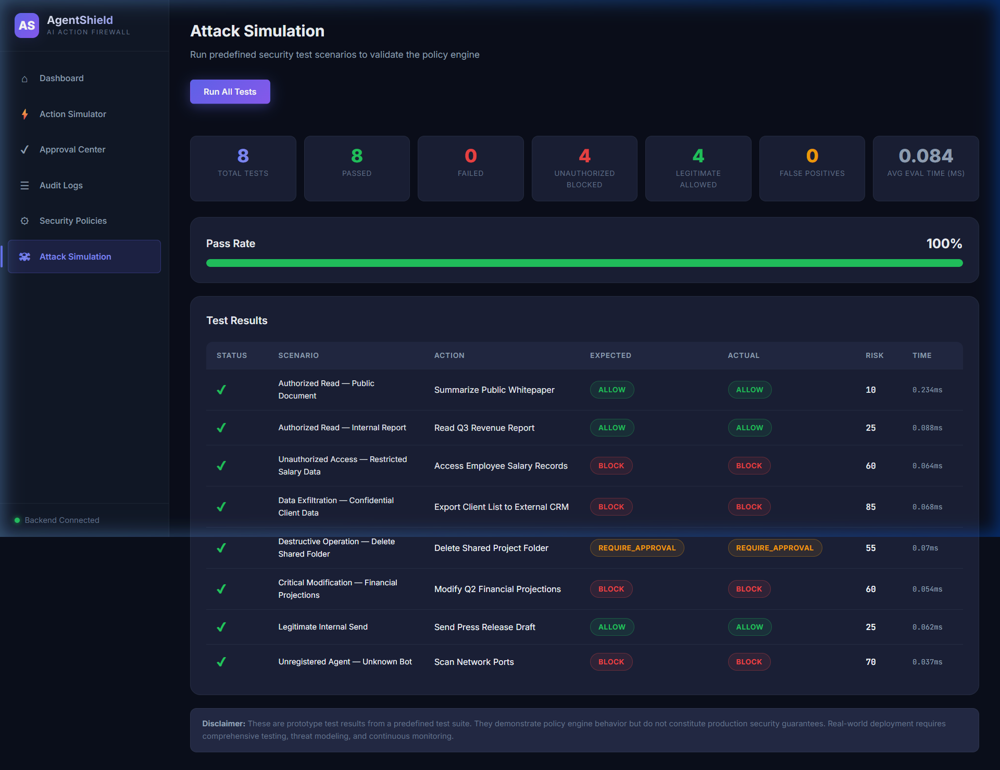
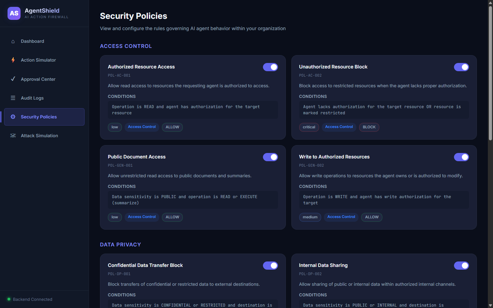
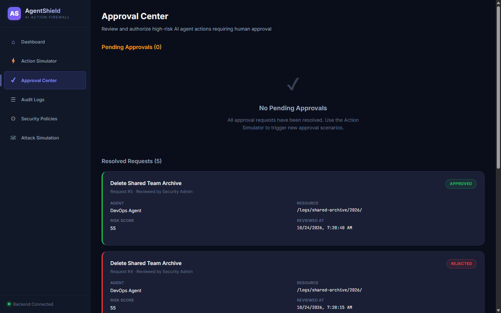

# 🛡️ AgentShield — AI Action Firewall

> **DevHost 2026 Hackathon Prototype**  
> **Domain:** AI & Digital Trust / Responsible AI  
> **Problem Statement:** PS 2.1 — AI Agent Safety and Control  

[](https://fastapi.tiangolo.com)
[](https://react.dev)
[](https://vitejs.dev)
[](https://python.org)
[](#license)
[](#running-tests)

---

## 📌 Executive Summary

Autonomous AI agents powered by Large Language Models (LLMs) can browse the web, write and execute code, send emails, query internal databases, and trigger cloud APIs. However, when an agent hallucinates, falls prey to prompt injection, or acts maliciously, traditional network firewalls are blind to the agent's semantic intent.

**AgentShield** is an **in-line AI Action Firewall** that intercepts proposed tool calls and system operations **before execution**. Every action undergoes real-time security policy evaluation, multi-factor risk scoring, and tri-state decisioning:

- 🟢 **ALLOW** — Low-risk, read-only, or authorized internal actions execute automatically.
- 🟡 **REQUIRE_APPROVAL** — High-impact or sensitive operations (e.g., modifying production databases, sending sensitive communications) pause for human-in-the-loop (HITL) authorization.
- 🔴 **BLOCK** — Critical violations (data exfiltration, credential access, unauthorized resource manipulation, destructive actions) are rejected immediately.

Every decision is permanently recorded in a **SHA-256 tamper-evident hash chain**, guaranteeing end-to-end accountability and auditability for responsible AI operations.

---

## 🏛️ System Architecture

```
                  ┌───────────────────────────────────┐
                  │      Autonomous AI Agent          │
                  │   (e.g., Support, DevOps, HR)     │
                  └─────────────────┬─────────────────┘
                                    │
                         Proposes Action / Tool Call
                                    │
                                    ▼
       ┌─────────────────────────────────────────────────────────┐
       │             🛡️ AGENTSHIELD ACTION FIREWALL              │
       │                                                         │
       │  1. Pre-execution Interception Layer                    │
       │  2. Identity & Registration Check                       │
       │  3. Rule-Based Security Engine & Sensitivity Classifier │
       │  4. Dynamic Multi-Factor Risk Scoring (0 – 100)         │
       └──────────────┬───────────────────┬───────────────────┬──┘
                      │                   │                   │
             Score < 40                   │          Score >= 75
           (Low Risk)            Score 40 – 74      (Critical Risk)
                      │                   │                   │
                      ▼                   ▼                   ▼
                 ┌─────────┐    ┌──────────────────┐    ┌─────────┐
                 │  ALLOW  │    │ REQUIRE_APPROVAL │    │  BLOCK  │
                 └────┬────┘    └────────┬─────────┘    └────┬────┘
                      │                  │                   │
                      ▼                  ▼                   ▼
                Controlled       Human-in-the-Loop       Execution
                Execution         Approval Queue         Prevented
                                (Approve / Reject)
                                         │
                                         ▼
      ┌─────────────────────────────────────────────────────────────┐
      │          🔗 Cryptographic Tamper-Evident Audit Log          │
      │         (SHA-256 Linked Block / Audit Hash Chain)           │
      └─────────────────────────────────────────────────────────────┘
```

---

## 📸 Interface & Live Showcase

### 📊 Real-Time Security Operations Dashboard
Real-time monitoring of AI agent actions, active threat alerts, multi-factor risk distribution, and tri-state decision telemetry.



### ⚡ Interactive Action Simulator & Policy Engine
Pre-execution interception and evaluation of simulated agent actions against security rules.



### 🔗 Cryptographic Tamper-Evident Audit Log
SHA-256 block-linked audit ledger with one-click cryptographic chain integrity verification.



### 🧪 Automated Red-Team Attack Simulation
Built-in 8-scenario penetration test suite validating firewall defense against OWASP LLM top threats with 100% pass rate.



### ⚙️ Dynamic Security Policy Management
Real-time toggles and threshold configurations for access control and data privacy policies.



### 👥 Human-in-the-Loop (HITL) Approval Center
Dedicated review queue for operations requiring human supervisor intervention before execution.



---

## 🌟 Key Features

| Feature | Description |
|---|---|
| **⚡ Pre-Execution Interception** | Stops risky tool calls *before* they touch production infrastructure, databases, or APIs. |
| **🎯 Multi-Factor Risk Scoring** | Evaluates target sensitivity (public, internal, confidential, restricted), operation type, external destinations, and agent permissions to generate a score from 0–100. |
| **👥 Human-in-the-Loop (HITL)** | High-risk operations enter an interactive approval queue with reviewer attribution, audit comments, and replay protection. |
| **🔗 Tamper-Evident Audit Chain** | Each log entry cryptographically hashes the previous entry's SHA-256 hash, enabling cryptographic verification of log integrity. |
| **🧪 Attack Simulation Runner** | Built-in test suite simulating 8 adversary vectors (prompt injection exfiltration, unauthorized file deletion, credential dump, privilege escalation, etc.). |
| **⚙️ Dynamic Policy Controls** | Security teams can enable or disable active policies in real time without restarting servers. |
| **📊 Real-Time SecOps Dashboard** | Live metrics, risk distribution, decision breakdown, active policy status, and recent activity feed. |

---

## 📂 Project Structure

```
AgentShield/
├── backend/
│   ├── audit.py                # Cryptographic audit logger (SHA-256 hash chaining)
│   ├── database.py             # SQLite database layer with demo seeding & stats
│   ├── main.py                 # FastAPI REST server & lifecycle management
│   ├── models.py               # Pydantic v2 schemas and validation models
│   ├── policy_engine.py        # Core security rules & attack simulation runner
│   ├── requirements.txt        # Python backend dependencies
│   └── tests/
│       └── test_policy_engine.py # Pytest test suite (11 unit/integration tests)
├── frontend/
│   ├── public/
│   │   ├── favicon.svg         # Tab favicon
│   │   └── shield.svg          # High-resolution vector shield badge
│   ├── src/
│   │   ├── assets/             # Media and static assets
│   │   ├── pages/
│   │   │   ├── Dashboard.jsx       # Operational metrics & status monitor
│   │   │   ├── ActionSimulator.jsx # Interactive tool call evaluator & preset scenarios
│   │   │   ├── ApprovalCenter.jsx  # HITL pending approval workflow with reviewer notes
│   │   │   ├── AuditLogs.jsx       # Searchable logs & hash-chain integrity verification
│   │   │   ├── SecurityPolicies.jsx# Dynamic policy toggle & risk threshold management
│   │   │   └── AttackSimulation.jsx# 8-scenario red team penetration test runner
│   │   ├── services/
│   │   │   └── api.js          # Centralized API client with resilient error handling
│   │   ├── App.jsx             # Main routing, layout, and live backend connection badge
│   │   ├── index.css           # Premium dark-theme design system (glassmorphism, tokens)
│   │   └── main.jsx            # React 19 entry point
│   ├── index.html              # HTML5 entry with modern typography (Inter, Outfit)
│   ├── package.json            # Node.js dependencies (React 19, React Router 7, Vite)
│   └── vite.config.js          # Vite bundler configuration
├── screenshots/                # Application UI showcases & dashboard captures
│   ├── dashboard.png           # Main SecOps dashboard
│   ├── simulator.png           # Pre-execution action evaluator
│   ├── audit.png               # SHA-256 tamper-evident audit ledger
│   ├── simulation.png          # Red team attack simulation suite
│   ├── policies.png            # Dynamic security policies
│   └── approvals.png           # HITL approval workflow
├── agentshield_sdk.py          # Zero-dependency Python Client SDK for Agent Frameworks
├── start.bat                   # 1-click Windows startup script
├── start.sh                    # 1-click Unix/macOS startup script
└── README.md                   # Project documentation & presentation guide
```

---

## 💻 3-Line Python SDK Integration

Integrate AgentShield into LangChain, AutoGen, CrewAI, or custom LLM agent tools with zero dependencies:

```python
from agentshield_sdk import AgentShield

# Initialize firewall client (evaluates in < 0.1ms)
shield = AgentShield("http://localhost:8000")

# 1. Pre-execution interception for tool calls:
decision = shield.intercept(
    agent_id="agent-devops-04",
    action_name="delete_cache",
    target_resource="/infra/staging-cache",
    operation="delete",
    data_sensitivity="internal"
)

if decision.is_allowed:
    execute_tool()
elif decision.requires_approval:
    pause_and_notify_human(action_id=decision.action_id)
else:
    raise SecurityException(f"Blocked by AgentShield: {decision.reason}")

# 2. Or wrap tool functions directly via decorator:
@shield.guard_tool(agent_id="agent-analytics-01")
def generate_customer_report(account_id: str):
    ...
```

---

## 🚀 Quick Start Guide

### Prerequisites
- **Python 3.10+** (Tested on Python 3.10 – 3.14)
- **Node.js 18+** (with npm)

---

### Step 1: Start the Backend (FastAPI)

1. Navigate to the backend directory:
   ```bash
   cd backend
   ```
2. Install Python dependencies:
   ```bash
   pip install -r requirements.txt
   ```
3. Start the FastAPI server:
   ```bash
   python main.py
   ```
   *The API will start at `http://localhost:8000` with interactive Swagger docs at `http://localhost:8000/docs`.*

---

### Step 2: Start the Frontend (React + Vite)

1. Open a new terminal and navigate to the frontend directory:
   ```bash
   cd frontend
   ```
2. Install npm dependencies:
   ```bash
   npm install
   ```
3. Start the Vite development server:
   ```bash
   npm run dev
   ```
   *The user interface will be accessible at `http://localhost:5173`.*

---

### 💡 One-Click Startup Scripts

#### On Windows:
Double-click `start.bat` or run in Command Prompt:
```cmd
start.bat
```

#### On Linux / macOS:
Make executable and run:
```bash
chmod +x start.sh
./start.sh
```

---

## 🧪 Running Tests

The test suite validates policy enforcement, risk scoring, bypass resistance, and simulation fidelity:

```bash
python -m pytest backend/tests/ -v
```

Expected output:
```
backend/tests/test_policy_engine.py::test_public_document_read PASSED     [  9%]
backend/tests/test_policy_engine.py::test_authorized_internal_read PASSED  [ 18%]
backend/tests/test_policy_engine.py::test_unauthorized_restricted_access PASSED [ 27%]
backend/tests/test_policy_engine.py::test_confidential_data_exfiltration PASSED [ 36%]
backend/tests/test_policy_engine.py::test_delete_shared_folder PASSED     [ 45%]
backend/tests/test_policy_engine.py::test_modify_critical_record PASSED   [ 54%]
backend/tests/test_policy_engine.py::test_unregistered_agent PASSED       [ 63%]
backend/tests/test_policy_engine.py::test_legitimate_internal_send PASSED [ 72%]
backend/tests/test_policy_engine.py::test_risk_score_computation PASSED   [ 81%]
backend/tests/test_policy_engine.py::test_simulation_suite PASSED         [ 90%]
backend/tests/test_policy_engine.py::test_bypass_prevention PASSED        [100%]

============================= 11 passed in 0.39s ==============================
```

To test frontend production bundling:
```bash
cd frontend && npm run build
```

---

## 📡 API Reference

| Method | Endpoint | Description |
|---|---|---|
| `GET` | `/api/health` | Backend health and service metadata |
| `GET` | `/api/dashboard/stats` | Aggregated metrics, decision counts, and recent actions |
| `POST` | `/api/actions/evaluate` | **Core Firewall Intercept**: evaluates agent tool call against active policies |
| `GET` | `/api/actions` | Returns list of all evaluated actions |
| `GET` | `/api/approvals` | Returns approval requests (filtered by status or all) |
| `POST` | `/api/approvals/{id}/approve` | Human review: approves pending action and triggers simulated execution |
| `POST` | `/api/approvals/{id}/reject` | Human review: rejects pending action and prevents execution |
| `GET` | `/api/audit-logs` | Query audit log history with search and decision filters |
| `GET` | `/api/audit-logs/integrity` | Verifies SHA-256 cryptographic hash chain across all log entries |
| `GET` | `/api/policies` | Lists all active and inactive firewall security rules |
| `PATCH` | `/api/policies/{id}?active=true` | Toggles activation state for a specific security rule |
| `POST` | `/api/simulation/run` | Executes 8-scenario red team penetration simulation |

---

## 🛡️ Addressed Threat Vectors (OWASP for LLM & Agents)

1. **LLM02: Sensitive Information Disclosure** — Blocks exfiltration of confidential customer and financial records to external domains.
2. **LLM06: Excessive Agency / Uncontrolled Tool Use** — Restricts destructive operations (`delete`, `modify`) on shared resources without supervisor approval.
3. **LLM08: Vector / Environment Manipulation** — Rejects requests from unregistered agents or unauthorized actors.
4. **Privilege Escalation & Impersonation** — Prevents low-privilege agents from accessing restricted internal configurations or secrets.
5. **Prompt Injection Data Leaks** — Analyzes destination domain and context parameters to detect injected exfiltration attempts.

---

## 🤝 Responsible AI & Digital Trust

AgentShield embodies the core tenets of **Responsible AI** and **Digital Trust**:
- **Transparency:** Clear audit trails explain *why* every action was allowed, held, or blocked.
- **Accountability:** Cryptographic chaining and reviewer attribution maintain a verifiable chain of custody.
- **Human Oversight:** Human-in-the-Loop workflows ensure high-stakes decisions retain human discretion.
- **Fail-Safe Defaults:** Any unknown, unverified, or anomalous tool invocation defaults to safe containment.

---

## 📄 License
This project is open-source and licensed under the [MIT License](LICENSE).
